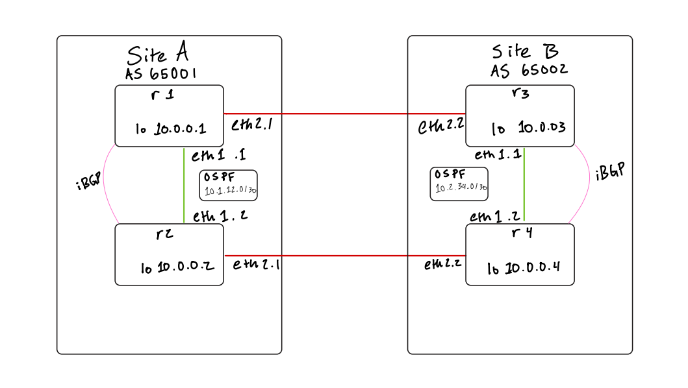

&nbsp;

# Routing Lab

I built a 4 router, two side network on my Proxmox homelab. I wanted to learn routing, and hands on I feel works the best. Each site runs OSPF internally, the 2 sites connect over redundant eBGP links, which gives it 2 links incase one fails, and I wrote Python scripts that build each routers config from a single invintory file and checks that the whole network came up healthy.

## Why?

I wanted to actually understand BGP and OSPF instead of just watching Youtube videos about them, and to practice the automation parts. So I had to describe the network as data, generate configs from it, and verify the result automatically instead of checking each router by hand.


## Topology



|Router|Site|AS Number|Loopback|
|---|---|---|---|
|r1|A|65001|10.0.0.1|
|r2|A|65001|10.0.0.2|
|r3|B|65002|10.0.0.3|
|r4|B|65002|10.0.0.4|

Routers in the same site also run iBGP between their loopbacks, so each site knows both the paths out.
## Stack

- Containerlab

     * Builds the topology from a YAML file
- FRRouting
   * Routing Software for OSPF and BGP
- Python w/ Jinja2 templates
     * For config generation and verification
- Runs in an Unbuntu VM on Proxmox homelab


## How it works

`inventory.yml` holds the info for each router. Things like the AS number, loopback, and links. The things that could be worked out from data like iBGP peers and advertised loopbacks arent typed in. They're computed by the generator. 

`generate.py` combines the inventory with `templates/frr.conf.j2` to write one config per router into `configs/`.

`verify.py` works out which each router should be talking to from the inventory. Then it asks every router who its actually talking to, to compare, and then prints a PASS/FAIL per session. If anything is down, it exits with code 1. 

`deploy.sh` runs all three of them. It generates, then redepolys, and then verifys. 

```
./deploy.sh
```

Before I automated it, I wrote all 4 configs by hand. The generator reproduces them exactly (`git diff` shows nothing), which is how I know the template is right. 

## What I tested

- Failover - I cut eBGP link 1 on r1 (`ip link set eth2 down`) and watched r1's route to r4:

    - Before: the distance was 20, through 172.16.13.2 on eth2 (straight to r3 over eBGP)
    - After: the distance was 200, through 10.0.0.2 on eth1 (recursive), the iBGP backup through r2

The route switched in a few seconds and ping from r1's loopback to r4's loopback kept working without loss. Bringing the link back up moved traffic back to the direct path.

- Catching a bad change - I changed one peer AS number in the inventory to something wrong (65001 to 65009) and redeployed. `verify.py` failed exactly two sessions, both ends of the broken link, passed the other 10, and exited with code 1. Traffic still flowed over link 2 the whole time, which is the point: the network looked fine, and the check still caught it.


## Things I learned

1. `next-hop-self` is the thing that makes the backup path work. Without it, r2 would be told to send traffic to r3's link address, which it has no route to do.
2.  Pinging from a link address fails but pinging from a loopback works, only loopbacks are advertised between sites.
3.  Failover was fast because FRR saw the interface go down. Something like a dead device mid cable, it couldnt see and could take up to the 180s from the BGP hold timer.


## Things I could add

* Connect the lab to AWS with a site to site VPN over BGP. I read about how its the same way companies connect their datacenters to the cloud, I feel like it could be a cool thing to add. 
* Continuing on the automation, I'd add a Github Action that runs the generator that checks each push.  
* BFD which is Bidirectional Forwarding Detection for super fast failure detection.

 &nbsp;
 
